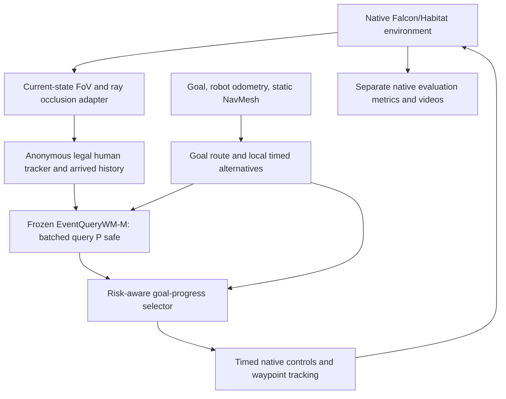

# EventWM closed-loop SocialNav milestone — 12 October 2026

EventQueryWM now participates in real native Falcon/Habitat navigation: legal
observations update after every action, the frozen model scores timed candidates,
the selector chooses one, and the robot executes its short scheduled prefix
before replanning. Eight complete WM episodes and eight matched static episodes
finished under native success or human-collision termination. No model training,
successor work, pairwise loss, Gaussian CV prediction, or external reactive robot
policy was used.

Both arms reached four goals and collided with humans in four episodes. The
milestone works; this pilot shows **no navigation success or collision advantage**
from EventWM. The model changed only three of 86 choices relative to static
selection at the same state; only two changed the next executable action prefix.

## Scope and exact identities

- Worktree: `/home/haodong/workspace/projects/eventwm-falcon/output/eventwm_closed_loop_checkout`.
- Branch: `research/eventwm-closed-loop-socialnav-20261012`, based on
  `b08af38d81910f45f1dbb911c5a40578ad637f51`. Resolve the delivered commit with
  `git rev-parse HEAD`; the handoff also records it outside Git.
- Output: `/home/haodong/workspace/projects/eventwm-falcon/output/eventwm_closed_loop_20261012`.
- Checkpoint: `output/eventwm_v4_full_scaling_20261012/runs/all_full_seed20261013/best.pt`
  relative to the main project. SHA256:
  `6478820b4fb1a109d5ba62282064257be98dd3fb6f1a3db0195eb1eff03ec09e`.
  Validation-selected step 2560; unchanged EventQueryWM-M, 1,035,649 parameters;
  trained on the previous frozen 188,265-query pool. Strict state-dict loading and
  actual CUDA inference succeeded. Output is **query P(safe)**, not navigation
  Success Rate, PSC, or a successor state.
- Runtime: existing `eventwm-falcon` environment, PyTorch 1.12.1,
  Habitat-Sim 0.3.1. Physical GPU 1 / logical `cuda:0`, one CPU thread, nice 19,
  idle I/O priority, one simulator worker. Shared packages and drivers unchanged.

The evaluation retains native `MultiAgentPointNavTask`, official metric code,
0.2 m success tolerance, terminal STOP, native human actors, contact-based human
collision termination, and the 500-step limit. Native continuous `BaseVelAction`
is **added to the default discrete robot action space** to execute the training
query's actual speed and WAIT. Continuous base motion also retains the standing
robot pose rather than the discrete walking animation. These are material
control-interface differences from published discrete-action baselines; this is
an integration comparison, not strict paper-action parity or a SOTA claim.

## Frozen episodes and isolation

`episodes.json` in the output froze eight official Social-HM3D validation
episodes before policy outcomes, one per distinct scene, seeds 20261012–20261019.
Selection used declared distance 2–8 m, then human count and declared distance.
All eight happen to contain two humans. Declared distances are 2.02–3.07 m;
native path distances must be measured separately because source metadata is
inconsistent with native geometry in some episodes. Start poses and goals match
between arms; source start differences are at most 3e-8 m from float conversion.

Evaluated manifest SHA256:
`cde70afee64e0020ac10b8cc973c5de5c7c9ec1b757bc20eed739a9a8abe7c83`.
The committed `configs/eventwm_closed_loop_20261012.manifest.json` preserves the
same membership, sources, hashes, and seeds, adding canonical episode-content
hashes for replay. Replay checks official source hashes and reconstructs those
exact episode contents; output-path and gzip-byte hashes can differ.

The training-overlap audit joined all 5,705 frozen training roots to the
read-only verified index. Four evaluation scenes occur in training and four do
not. Both policies achieve 2/4 successes and 2/4 collisions in each stratum.
This is a small post-hoc scene partition; episode/trajectory disjointness from
training is not certified by that scene audit. Do not interpret this pilot as a
powered unseen-scene or independently held-out final benchmark. The previous
frozen planning bank and its episodes remain untouched.

Production was only read through SQLite `mode=ro`/`query_only` and existing logs.
Final verification found runner PID 3296093 alive, native cap C24, source
`eac1c27813a753d26fc1756671d8d0bd198a65c6`, pipeline settings unchanged, and
all five protected worker/collector source hashes unchanged with a clean tracked
production checkout. The final saved sample contained 213,378 retained queries
and 6,466 completed roots. No production control API was called.

The publication guard conservatively stopped one research attempt after three
checks below 75% of the original 3,898 queries/hour reference. The collector was
not stopped. Research resumed after publication recovered, retaining that
reference and seeding the monitoring window from existing collector logs.
Admission/publication is bursty: the decline is not established as caused by
research. Final actuator-audit monitoring measured about 6,256 queries/hour over
ten minutes. All research navigation processes are now idle.

## Implemented loop



`closed_loop_runtime.py` binds the native task, explicit legal adapter, private
NavMesh cache, real robot actions, logging, and terminal measurements.
`eventquerywm/navigation.py` supplies goal-query generation, immutable WM
inference, selection, and timed control. `closed_loop_nonvisual.py` provides the
process-local renderer-free camera-geometry adapter. The simulator's actual
moving jaw node supplies calibrated camera pose. No fake pixels are generated.

Perception is initially **simulator-backed ideal current visible detections**:
90-degree horizontal/vertical FoV, 10 m range, ray occlusion including static
objects, other humans, and dynamic objects. Hidden detections are withheld.
Anonymous association and velocity estimation use past detections only; tracks
expire after two seconds. The detector boundary can be replaced by depth
tracking without changing model tensorization. Track IDs are bookkeeping, not
numerical neural features. Privileged visibility witnesses and video overlays
are separate evaluation outputs. Native future human waypoints are used only
by the environment's actors, never the robot policy.

Static global paths are clipped to 1.5 m. Feasible local left/right endpoints
use a 0.35 m offset where available. Each path has normal 0.7 m/s, half-speed,
and 0.5 s delayed timing, plus a nonterminal stationary WAIT: at most ten
candidates. Generation uses only goal, odometry, and static geometry. Native
NavMesh step checks are a center-path feasibility test, not a full articulated
rotation-footprint proof. The checkpoint receives its original history and
16-token timed-query representation; NavMesh is used by generation, not added
as an untrained neural input.

The initial selector prefers efficient goal progress among candidates below
20% predicted query collision risk, otherwise uses the lowest-risk band.
Cost is duration times nominal speed divided by goal progress, a dimensionless
normalization of seconds/metre. Motion-family hysteresis is shared with static;
WM adds a 0.02 risk band. WAIT requires lower learned risk and a finite waiting
budget; repeated delayed choices are also bounded. These thresholds are an
initial heuristic, not a calibrated safety guarantee. Static uses the same
generator and controller, with no learned or CV human-risk estimator.

Ten common zero-control initialization steps count toward the native budget.
History then grows causally up to eight seconds; the first WM call has about
0.49 s history, shorter than the collector's mature histories. This is a
concrete input-distribution difference, not a demonstrated cause of failure.
The loop executes about 0.5 s / ten native steps per choice, then replans.
Clock calibration measures native time, preserving compiler integration units.
Tracking aborts and replans after excessive position/heading deviation. STOP
is issued only near the goal. WAIT is native `[0,0]` base velocity.

## Matched benchmark results

All entries are paired on the frozen episodes and seeds. PSC is the official
per-episode fraction of compliant steps, averaged across episodes. Collision
and Success Rate use native benchmark definitions, not query SR labels.

| Policy | Episodes | Navigation success | SPL | PSC | Human collision | Timeout / stuck | Successful time | Mean planning |
|---|---:|---:|---:|---:|---:|---:|---:|---:|
| Static, WM disabled | 8 | 50% | 0.500 | 0.8750 | 50% | 0 / 0 | 7.83 s | 36.5 ms |
| EventWM + selector + local control | 8 | 50% | 0.500 | 0.8948 | 50% | 0 / 0 | 7.83 s | 85.5 ms |

| Frozen episode | Static / WM outcome | Static / WM steps | Static / WM PSC |
|---|---|---:|---:|
| HMkoS756sz6 / 0 | Success / Success | 131 / 131 | .8702 / .8702 |
| YRUkbU5xsYj / 6 | Success / Success | 141 / 141 | 1 / 1 |
| q5QZSEeHe5g / 3 | Success / Success | 141 / 141 | 1 / 1 |
| 8CRYizAb6yd / 10 | Success / Success | 231 / 231 | 1 / 1 |
| bCPU9suPUw9 / 10 | Collision / Collision | 88 / 67 | .6023 / .7612 |
| LEFTm3JecaC / 13 | Collision / Collision | 88 / 88 | .7614 / .7614 |
| RJaJt8UjXav / 5 | Collision / Collision | 65 / 65 | .9231 / .9231 |
| FnSn2KSrALj / 6 | Collision / Collision | 70 / 70 | .8429 / .8429 |

The entire 0.0199 mean PSC increase comes from bCPU9suPUw9, where WM collided
21 steps earlier. It does not establish improved social avoidance. Successful
navigation time and path efficiency are identical; successful path efficiency
is 1.0 in both arms. Averaging time over all outcomes gives 5.805 s static and
5.677 s WM, shortened by the earlier collision, not faster goal completion.
The old raw initial-distance/path-length ratio saturates at one on truncated
failures and is excluded from aggregate path-efficiency claims; use native SPL.

Across 86 batched WM calls: inference median 6.37 ms, mean 25.82 ms, p95
181.01 ms. Each episode starts a fresh process: first-call mean 216.39 ms
dominates the tail. Planning median is 58.23 ms, mean 81.13 ms, p95 222.28 ms.
The table uses episode-averaged planning; call-weighted summaries differ.
Planning wall latency is logged, not added artificially to native simulation
time. No new neural future-state output is claimed.

All 16 runs had zero detected stuck episodes, waypoint-tracking failures,
planner oscillation failures, and candidate-generation failures. The first WM
success executed 131 native actions, updated history after each action, made
12 model calls/replans, and reached the goal with SPL 1.0. Its maximum sampled
tracking error was 3.3e-7 m. The separate native timing check measured:

| Ten-step actuator diagnostic | Native elapsed time | Traveled distance |
|---|---:|---:|
| Normal compiled motion | .480 s | .32615 m |
| Half-speed compiled motion | .480 s | .16575 m |
| WAIT | .488 s | 0 m |

Slow/normal distance ratio is .5082; compiler step quantization explains the
small departure from .5. WAIT remains nonterminal; subsequent native STOP
terminates. These actuator diagnostics are excluded from benchmark totals.

## Failure evidence and next experiment

WM selected only normal-speed queries in this pilot. Three choices differ
from static at the same WM-visited state; one changes only the unexecuted query
tail, leaving the ten-step control prefix identical. Two change that prefix.
This is an instantaneous counterfactual diagnostic, not three alternative
navigation rollouts. It proves predictions affect control but shows limited
intervention frequency on this panel.

| WM collision episode | Last selected P(safe) | Legal perception at last decision |
|---|---:|---|
| bCPU9suPUw9 / 10 | .8619 | One remembered track, age .296 s; none currently visible |
| LEFTm3JecaC / 13 | .7707 | One remembered track, age 1.072 s; none currently visible |
| RJaJt8UjXav / 5 | .9794 | No human ever detected in the episode |
| FnSn2KSrALj / 6 | .7500 | No current tracks; 13 earlier visible-observation frames |

These estimates precede collisions within the executed prefix. They warrant
investigation of learned risk, lost visibility, and selection. Remembered
tracks are not certified as the particular colliding human. Unexecuted
alternatives have no native outcomes, so poor candidate coverage versus poor
risk selection cannot yet be separated. A full-query safe probability also
does not supply calibrated risk for a replanned prefix or entire episode.
The history-length and action-interface differences above are measured
representation changes, not established explanations for model failure.

The highest-value next experiment is a **predeclared fixed-checkpoint
risk-budget sweep on 32 frozen human-balanced episodes**, retaining candidate
generation, control, perception, and a matched static arm. Test whether lower
budgets increase distinct executable-prefix interventions and improve native
success/collision/PSC; keep failed outcomes and waiting/time costs. This tests
the selector's use of WM information before spending resources on training or
larger architectures. The current eight episodes should remain the engineering
development panel. No current result supports a larger network, successor-head
work, a CV fusion, or a SOTA claim. Falcon, ORCA, A*, and Gaussian CV have not
been run under this matched protocol and remain external comparison baselines.

## Artifacts, tests, and reproduction

Compact numerical results are committed under
`research_results/eventwm_closed_loop_20261012/`: paired comparison, per-episode
CSV, legal-input/choice diagnostics, scene-overlap audit, actuator summary,
production verification, and an artifact hash index. Large logs, videos,
NavMeshes, and the existing checkpoint are kept outside Git in the output.
Each native episode saves resolved config, source hashes, checkpoint/manifest
provenance, initial pose/goal, robot trajectory, observations, full candidate
queries and scores, selected IDs, commands, replanning timestamps, goal
distances, official metrics, terminal reason, and planning/inference latency.

Representative files, relative to the output directory:

- `first_episode_demonstration/eventwm/ep000_HMkoS756sz6_0/navigation.mp4`:
  successful complete WM rollout.
- `videos/ep004_bCPU9suPUw9_10_eventwm_diagnostic.mp4`:
  collision case replayed from the actual logged native poses and ray witnesses.
- `goal_progress.png`: paired native goal-distance curves.
- `runs/{static,eventwm}/<tag>/metrics.json`: valid final native outcomes.
- `control_timing_audit/timing_audit.json`: real slow/WAIT/STOP checks.

EGL rendering failed to associate CUDA device 0 with available EGL devices.
CUDA neural inference nevertheless works. Drivers/shared environments were
not changed. Videos are **privileged top-down native-pose evaluation overlays**,
not rendered RGB or policy-visible omniscient tracking. Interrupted partial
media are preserved separately under `interrupted_attempts`; the earlier
static implementation is under `iterations/static_before_shared_hysteresis`
and excluded from the final matched comparison.

The first three WM observation logs retain sensor inventory names from before
the headless metadata correction. No RGB/depth arrays existed or entered the
model; tensorization ignores that metadata field. Current code records an empty
rendered-sensor inventory in renderer-free mode. Per-attempt source hashes
preserve this distinction without rewriting observations.

Eight unit tests pass for learned-risk-dependent choice, WM-disabled choice,
shared hysteresis, bounded waits/delays, real slow control magnitudes, exact
zero WAIT, legal tensor/clock representation, and bent route clipping. Native
episodes and actuator checks provide the integration evidence. Manifest replay,
completed-run resume/skip, cooperative stop/status, and exclusive output locks
are also checked. Resume restarts an interrupted episode from its fixed seed;
it does not claim exact-frame simulator checkpointing.

From the isolated checkout, reproduce in a **new output directory**:

```bash
cd /home/haodong/workspace/projects/eventwm-falcon/output/eventwm_closed_loop_checkout
REPLAY_OUT=/home/haodong/workspace/projects/eventwm-falcon/output/eventwm_closed_loop_reproduction_20261012
scripts/run_eventwm_closed_loop.sh freeze --from-manifest configs/eventwm_closed_loop_20261012.manifest.json --output "$REPLAY_OUT"
scripts/run_eventwm_closed_loop.sh start --output "$REPLAY_OUT" --video
```

`start` runs the matched suite in the foreground, one worker at a time.
Default perception is renderer-free. Use a second terminal for controls:

```bash
scripts/run_eventwm_closed_loop.sh status --output "$REPLAY_OUT"
scripts/run_eventwm_closed_loop.sh stop --output "$REPLAY_OUT"
scripts/run_eventwm_closed_loop.sh resume --output "$REPLAY_OUT"
scripts/run_eventwm_closed_loop.sh summarize --output "$REPLAY_OUT"
```

Stop touches only that output's `STOP_RESEARCH` flag. Active episodes exit
cooperatively and are excluded until completed on resume. The guard may
terminate only its directly owned research child. Resume acquires the
exclusive output lock before clearing the flag. Default status/stop/resume
without `--output` address the delivered, completed pilot.

Bounded first-episode and actuator reproductions:

```bash
scripts/run_eventwm_closed_loop.sh start --output "$REPLAY_OUT" --limit 1 --video
scripts/run_eventwm_closed_loop.sh timing-smoke --output "$REPLAY_OUT"
nice -n 19 env OMP_NUM_THREADS=1 OPENBLAS_NUM_THREADS=1 MKL_NUM_THREADS=1 /home/haodong/miniforge3/envs/eventwm-falcon/bin/python -B -m unittest discover -s tests -p test_closed_loop_navigation.py -v
```

Recompute offline diagnostics/video without another navigation rollout:

```bash
nice -n 19 env OMP_NUM_THREADS=1 OPENBLAS_NUM_THREADS=1 MKL_NUM_THREADS=1 /home/haodong/miniforge3/envs/eventwm-falcon/bin/python -B scripts/closed_loop_analysis.py --plot --video-tag ep004_bCPU9suPUw9_10
scripts/run_eventwm_closed_loop.sh verify-isolation
```

For a larger fixed comparison, freeze membership before running either arm:

```bash
LARGER_OUT=/home/haodong/workspace/projects/eventwm-falcon/output/eventwm_closed_loop_balanced32
scripts/run_eventwm_closed_loop.sh freeze --output "$LARGER_OUT" --episodes 32 --balanced-humans --min-distance 2 --max-distance 12
scripts/run_eventwm_closed_loop.sh start --output "$LARGER_OUT"
scripts/run_eventwm_closed_loop.sh status --output "$LARGER_OUT"
```

This launches the present fixed selector, not an implemented risk-budget sweep.
Do not run it concurrently with other expensive research. Production retains
priority; review the throughput guard and episode failures before expanding.
