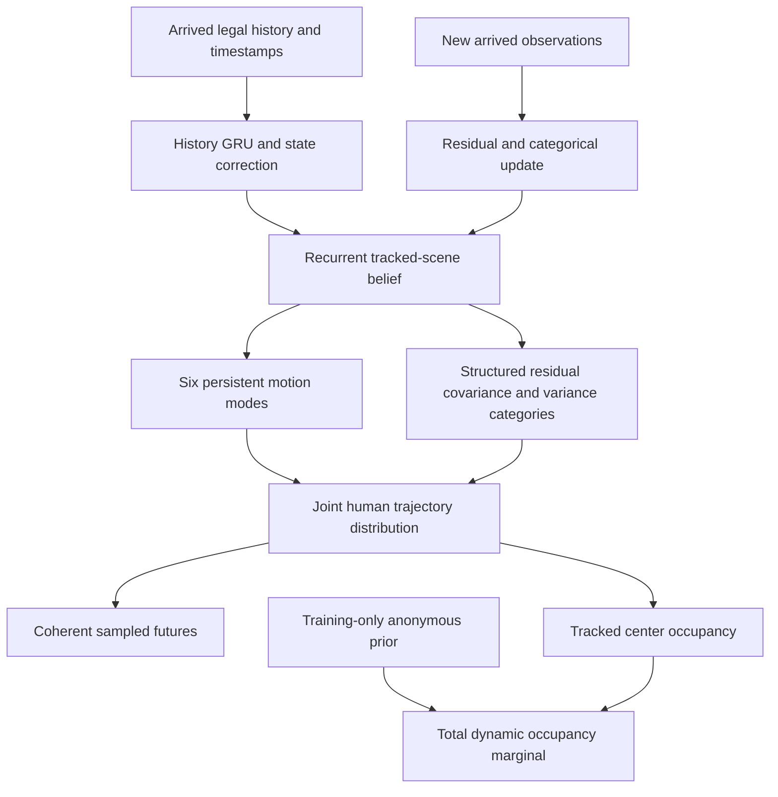
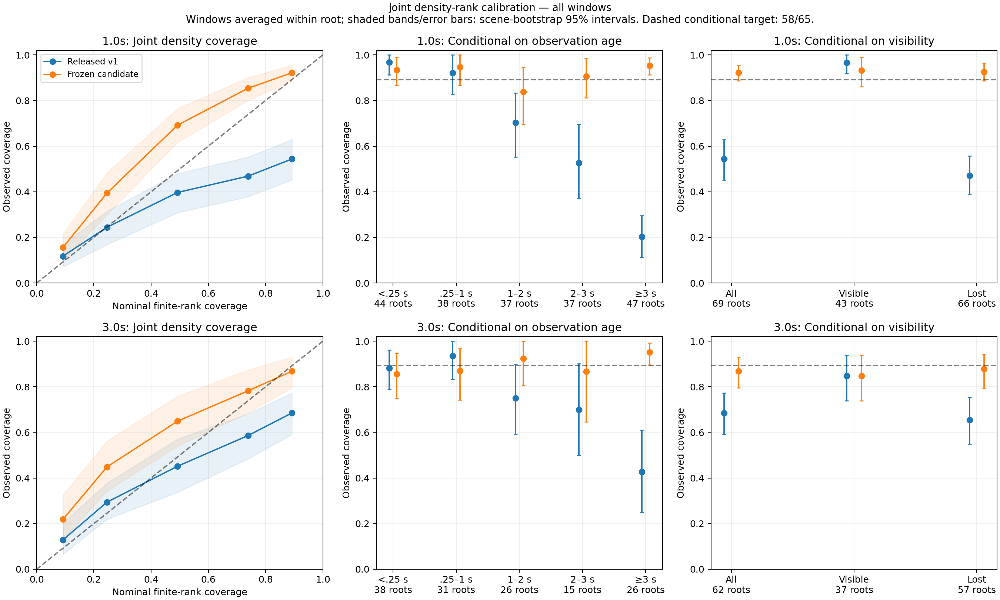

# EventWM Forecasting v2 — probabilistic recurrent LDM research

This branch contains the completed EventWM forecasting campaign: source, training
and evaluation pipelines, calibration and occupancy implementations, configurations,
tests, aggregate results, and reproducible artifact identities.

**The final primary remains the original v1 Learned Dynamics Model (LDM).** New
age-aware probability models improve likelihood, occupancy probabilities and
natural-distribution high-level coverage, but exceed the preregistered Energy
Score tradeoff and over-cover some central prediction sets. They are retained as
alternatives. We do not report a new primary-model improvement.

The research source was frozen at
`d593958f634b449317cc341ff2415048cded8061`. This publication is a curated source
copy on the requested GitHub branch, based on repository `main`; it does not
publish unrelated local experiment history. Exact copied file hashes are in
[publication/source_identity.json](publication/source_identity.json).
The original Falcon documentation is preserved in [README_FALCON.md](README_FALCON.md).

## Scope and motivation

Forecast coherent distributions over human motion and dynamic occupancy from
arrived legal observations under intermittent visibility. Trajectory accuracy,
proper probabilistic scores, conditional calibration, occupancy and recurrent
belief consistency are separate objectives. Human dynamics are exogenous and
independent of a candidate robot query.

This is a **pretrained LDM with recurrent forecasting belief interfaces**, not a
complete Layer-2 World Model. The Query-Conditioned Belief Adapter has **not** been
implemented. The next stage is:

```text
Pretrained LDM → Query-Conditioned Belief Adapter → Joint Fine-tuning → Complete Layer-2 WM
```

That stage is not started here. No RL selector, navigation policy or planning
loss was trained in this campaign. Legacy `eventquerywm` code is included because
its legal-input adapter is a dependency; its name does not imply completion of
the new Query-Conditioned Belief Adapter.

## Implemented architecture

The retained primary has a width-128 history GRU, legal-history initial-state
correction, six persistent scene motion modes, 0.25-second recurrent acceleration
residuals, an integrated OU residual law and persistent per-agent variance
categories. Its physical objective is joint Energy Score plus .05 normalized
trajectory NLL through three seconds. It stores approximately 530k parameters;
approximately 440k participated in the physical objective. Unused compatibility
heads are quarantined from the released forecasting interface.



The age-aware alternative propagates initial covariance over time since actual
acquisition, fits conditional variance probabilities over all supported fitting
windows with root balancing, and adds geometry-conditioned anonymous occupancy.
Other implemented alternatives include a persistent stopped-motion regime and
horizon-balanced calibration. None changes hidden observations into legal input.
Detailed equations, geometry semantics and limitations are in
[MODEL.md](research_results/eventwm_forecast_performance_v2_20261015/MODEL.md).

## Inputs, outputs and recurrent interface

`encode_history / imagine / observe` accepts legal tracked observations, acquisition
and frame timestamps, robot-frame context and permitted static geometry. Track IDs
provide legal slot association; simulator identities, future positions/observations,
ground-truth velocity/goals and candidate robot queries do not condition human
prediction. The tracker itself was not redesigned.

The standalone CLI reads a legal-history JSON and optional sensor JSON/static-map
NPZ. It exports an NPZ containing scene-mode means and weights, coherent sampled
paths, covariance and variance categories, track IDs/support, times, and tracked/
combined human-center occupancy. Coordinates are planar metres in the final legal
robot frame. The occupancy grid is 32×32 over ±8 metres; it is not a swept-body
collision or certified free-space map. Anonymous occupancy is a marginal prior,
not exact trajectories for never-observed humans.

Use the forecast's persistent sample state when composing stochastic segments.
After an observation update, sample from the updated posterior. Delayed correction
uses the documented at-most-one-.25s-tick approximation. See
[INFERENCE.md](research_results/eventwm_forecast_performance_v2_20261015/INFERENCE.md)
and [RECURRENT.md](research_results/eventwm_forecast_performance_v2_20261015/RECURRENT.md).

## Installation and a data-free interface check

Core inference and tests use Python 3.9, NumPy 1.23.5, PyTorch 1.12.1 and SciPy
1.13.1. The historical plot environment uses Matplotlib 3.3.2. Install the pinned
research dependencies in an isolated environment:

```bash
git clone --branch publish/eventwm-forecast-performance-v2-20261015 --single-branch \
  https://github.com/HeHaodong2004/Falcon.git
cd Falcon
python3.9 -m venv .venv-eventwm
. .venv-eventwm/bin/activate
python -m pip install -r requirements-eventwm.txt
export PYTHONPATH="$PWD/scripts:$PWD/tests"
export OMP_NUM_THREADS=1 MKL_NUM_THREADS=1 OPENBLAS_NUM_THREADS=1
python -B -m unittest discover -s tests -p 'test_forecast*.py' -v
python -B publication/interface_smoke.py
```

The suite has **97 passing tests**. The interface smoke needs no checkpoint or
corpus and uses an **analytic CV model, not the trained LDM**. It verifies finite
coherent samples and exact composed sampling on an authored synthetic history.
The full working [environment inventory](publication/environment_reproduction.yml)
and [version receipt](publication/environment_v2.json) are included.
Installation versions come from the tested environment; a fresh cross-platform
package installation is not claimed to have been validated. Older Matplotlib
may require its platform build dependencies. Habitat is unnecessary for this
inference/test path; raw scene extraction additionally needs Habitat-Sim/Lab 0.3.1,
its matching build and licensed assets described by the upstream documentation.

## Verified trained-model inference

Checkpoint binaries and datasets are **external artifacts**, not included in this
Git branch. [artifact_manifest.json](publication/artifact_manifest.json) gives
all six checkpoint hashes, sizes, seed roles and the verified local release
location. Exact recipe/calibration metadata is in [publication/model_configs](publication/model_configs). It does not claim a public download. Authorized artifact holders can run:

```bash
export EVENTWM_CHECKPOINT=/absolute/path/to/release_forecast_v2_20261015/primary.pt
python -B publication/verify_artifacts.py --checkpoint "$EVENTWM_CHECKPOINT" --role primary
python -B publication/example.py --checkpoint "$EVENTWM_CHECKPOINT" --role primary \
  --output /tmp/eventwm_primary_example_NEW.npz
```

The example verifies the checkpoint hash before loading and uses the included
synthetic legal history, not a collected scene or target cache. For an alternative,
use its checkpoint and matching role from the manifest, for example
`--role age_calibrated_alternative`. Outputs must have a new filename. A GPU is
optional via `--device cuda:0`; the default is CPU with legal-history preparation
on CPU. Direct invocation with your own legally obtained observations is:

```bash
python -B -m eventforecastwm.inference --checkpoint "$EVENTWM_CHECKPOINT" \
  --history publication/examples/history.json --sensor publication/examples/sensor.json \
  --device cpu --cpu-preparation --horizon 3 --samples 6 --seed 7 \
  --output /tmp/eventwm_direct_NEW.npz
```

All six local release checkpoints passed finite deterministic inference from the
sealed source archive under a Python-audited legal-file boundary. Primary,
replicate and both age-aware outputs exactly matched their worktree arrays.
The publication example is separately checked on the actual retained checkpoint.
This demonstrates inference correctness, not synthetic-example forecasting quality.

## Dataset preparation and training

All fitting used `eventwm_350k_belief_snapshot_20261014`: 348,777 validated queries,
10,569 roots and 534 scenes. The fitting membership contains **8,965 independent
roots and 48,434 windows**; development has 256 roots and 1,423 windows. Roughly
33 query branches per root are not independent human futures.

The archived protocol fixes root, episode, fixture, trajectory and scene exclusions.
Feature caches contain legal histories separately from supervised future targets.
Complete tracked trajectories and complete-scene occupancy have different support;
anonymous/associated labels are separated before rasterization. Observation age
means time since acquisition, which can exceed the tracker's two-second current-
table retention when a supplied belief history retains old slots.

The campaign completed eight 1k-root interventions, two matched 4k-root runs and
two 8,965-root full fits: **147,456 new physical updates / 6,270,924 root
presentations**. Each new full seed completed 24,576 updates / 1,562,598
presentations at batch 64. All fitting windows were used. Original model controls
are immutable references, not newly counted v2 training. Both new physical runs
resumed their saved weights, Adam/RNG/sampler/counters exactly; raw interim ES was
not treated as the final calibrated comparison.

[TRAINING.md](research_results/eventwm_forecast_performance_v2_20261015/TRAINING.md)
records budgets and convergence. [DATA.md](research_results/eventwm_forecast_performance_v2_20261015/DATA.md)
and [REPRODUCE.md](research_results/eventwm_forecast_performance_v2_20261015/REPRODUCE.md)
provide exact frozen-data preparation, training, calibration, evaluation,
launch/status/stop/resume and release-verification commands. The complete
historical JSON configurations are included. They are intentionally path-bound
cv-w06 receipts, not portable commands that silently reconstruct missing data.
Full result reproduction requires authorized original artifacts and their frozen
layout; changing identities requires a separately versioned protocol.

The preparation helper provides separate primary, probability-alternative,
full-physical-control and evaluation-only recipes. It creates new run directories,
never overwrites completed runs, and verifies producer dependencies. The collector
sharing policy targets 1,500 q/h, accepts 1,000–1,500, throttles after three valid
sub-1,000 windows and recovers after two above 1,500. Hard health/RAM/disk/OOM
constraints remain. The machine-specific collector guard must not be represented
as a generic scheduler for an unrelated host.

No 500k training ran: the final validated count was 457,314, below the unchanged
495,000 gate. A separately audited 444,774-query snapshot supplied confirmation
only. The incremental 500k recipe preserves inherited membership and avoids raw
archive duplication; its positive end-to-end training path remains unexecuted.

## Evaluation and confirmed results

Selection used development only, with a preregistered multiobjective rule and a
3% allowable ES tradeoff for a clear probability/occupancy gain. Models, seeds,
calibration and membership were committed before opening genuinely new natural
and unseen confirmation banks. Each has 128 roots; three-second trajectory support
is 53/73 roots and foreground occupancy AP support is 84/92. The old opened
confirmation banks were not tuned against or relabeled untouched.

Comparisons use identical support, 48 stratified samples per Energy Score bank,
fixed K=6 minimum-error samples, 64-draw joint density ranks and paired 1,000-
replicate scene-bootstrap intervals. Joint NLL is normalized per spatial coordinate.
One, two and three seconds are reported; five seconds is separate extrapolation.

| Frozen model | Natural ES3 ↓ | Unseen ES3 ↓ | Natural coverage3 | Natural AP3 ↑ | Unseen AP3 ↑ |
|---|---:|---:|---:|---:|---:|
| v1 primary, seed 14 | 1.152000 | .783836 | .679245 | .075280 | .091217 |
| Age-aware seed 14 | 1.166005 | .791999 | .886792 | .090451 | .103533 |
| v1 replicate, seed 15 | 1.170511 | .790761 | .698113 | .071746 | .099021 |
| Age-aware seed 15 | 1.212504 | .815071 | .867925 | .088729 | .113011 |
| Original calibrated CV | 2.203736 | .963494 | .566038 | .078964 | .120514 |
| CV with the same geometry prior | 2.203736 | .963494 | .566038 | .085315 | .126312 |

Nominal coverage is 58/65 = .892308. Seed-14 age-aware natural NLL3 improves
by .313482 nats/coordinate, with paired 95% interval [.199875,.433775] for the
improvement. Natural coverage improves .207547 [.107096,.314815]; AP improves
.015171 [.007410,.024456]. NLL, occupancy Brier and occupancy log-score gains
replicate across seeds and banks.

However, natural ES2 worsens **9.72% / 7.13%**, with paired intervals excluding
zero. Central natural one-second coverage becomes .719/.684 against nominal
.492, and the unseen replicate's ES3 worsens 3.07% with its interval excluding
zero. These regressions prevent primary promotion. Unseen occupancy remains
below CV. The family decision retains both original v1 roles; no test-ranked
alternative or seed is substituted.

Full tables, support counts and uncertainty estimates:
[confirmation report](research_results/eventwm_forecast_performance_v2_20261015/CONFIRMATION.md),
[all ten models](research_results/eventwm_forecast_performance_v2_20261015/CONFIRMATION_TABLES.md),
[development table](research_results/eventwm_forecast_performance_v2_20261015/DEVELOPMENT_BENCHMARK.md),
[machine-readable paired comparisons](publication/results/confirmation_comparisons.json).



## Ablations and limits

Age propagation and root-balanced all-window conditional variance fitting explain
older-history likelihood gains. Geometry-only anonymous occupancy improves spatial
probabilities. Persistent stopped-motion alternatives improve NLL/AP further but
have different ES/central-coverage costs. Removing cross-agent messages helps at
4k roots but fails to retain its advantage after full-data two-seed calibration.
Velocity revision, shorter motion windows, polar dynamics, distinct-arrival
encoding, occupancy BCE weights 2/10 and older-window sampling did not qualify.
Legal observation dropout was not executed and is not called a failed experiment.
See [ABLATIONS.md](research_results/eventwm_forecast_performance_v2_20261015/ABLATIONS.md)
and the complete [experiment ledger](research_results/eventwm_forecast_performance_v2_20261015/EXPERIMENTS.md).

Neither family is uniformly calibrated. v1 remains overconfident under old
histories. The age-aware alternative can overdisperse easy/central cases. Extreme
speed/acceleration tails improve, but outside-grid and eroded-navmesh proxies
worsen. No sample was silently rejected. Scene modes induce dependence, while
residual innovations remain conditionally independent across agents. Anonymous
occupancy has no complete joint temporal scenario law. Identity births/ReID,
complete scene beliefs and wall feasibility remain unresolved. Five-second
predictions exceed the physical training horizon.

The most promising remaining LDM hypothesis is separating state-estimation and
future-process uncertainty across horizons; it is not a confirmed improvement.
The next requested adapter/joint-fine-tuning stage remains future work.

## Reproducibility and provenance

The final local queue completed all 186 jobs with no pending/blocked work. Twelve
new physical fits completed. Earlier failed diagnostics, superseded pauses and
unexecuted scaling jobs remain honestly classified. The original release, full
optimizer checkpoints and production collector were preserved. An isolated CUDA
calibration fault recovered after a bounded chunk replay and hash checks; no
physical state was reset. A supplementary population-routing error was corrected
without changing frozen confirmation scores or model bytes.

[Research validation](publication/results/research_validation.json) records the
sealed 653-file local release, 97 tests and archive inference. Publication checks
are recorded separately in `publication/verification.json`. This branch contains
no raw dataset, cache, full optimizer state or checkpoint binary. The manifest
states exactly which external artifacts are needed. This is not a claim that
full-data experiments can be rerun from a Git clone without those artifacts.

The upstream software license and dataset/derived-artifact restrictions are
separate; see [THIRD_PARTY_NOTICES_EVENTWM.md](THIRD_PARTY_NOTICES_EVENTWM.md).
