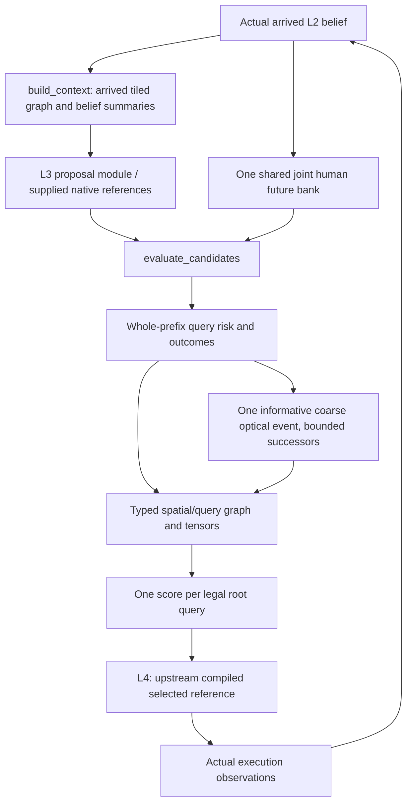

# Query outcome compiler v1

The implementation is `eventwm_graph.l25`. It has no trainable parameters,
policy, simulator, truth reader, collector control or executor. The frozen
`cf197122` L2 is its only prediction engine. The baseline gate passed before
this package was written; see [BASELINE_VERIFICATION.md](BASELINE_VERIFICATION.md).

## Stage A

`QueryOutcomeCompiler.build_context(actual_belief, actual_belief.graph,
actual_belief.robot_pose, public_goal_xyz)` produces a `ContextGraph` without
forecasting. It checks model ownership, actual role, arrived graph object,
ego/time consistency and terminal status. A stale context cannot be evaluated
after a different actual belief has been activated in that compiler instance.

Spatial regions are connected components within 4×4-cell tiles, with identical
support state and at most 2 cm height deviation from the seed cell. Their
geometry records mean center/height and bounding extent, not a filled polygon
or body-clearance certificate. Disconnected patches remain separate. Directed
connectivity exists only across adjacent certified free cells whose actual
heights differ by at most .22 m. Query feasibility separately uses the original
L2 swept native body-support validator, on the uncoarsened arrived graph.

Missing geometry maps to one explicitly unsupported external UNKNOWN node.
It has no traversable edges or fabricated coordinates. Explicit occupied and
unknown cells retain separate support states. Neither adjacency nor static
certification establishes human absence, optical visibility, or a full-body
trajectory between tile centroids.

The graph carries relative public goal geometry, arrived ego heading, tracked
presence/age/covariance summaries, association diagnostics and the unlocalized
population expectation. Mean-to-region track assignment is a belief summary,
not calibrated occupancy. Slot IDs are internal hypotheses, not physical human
identities. Last-seen age is the existing L2 mixture-weighted age.

## Stage B

`evaluate_candidates(context, references, ComputeBudget(...))` checks unique
query IDs, immutable content hashes, graph revision, ego and absolute start time.
`CompiledReference.from_native` is a compatibility adapter, not a nominal motion
compiler. It retains the existing compiler's route, target, yaw, actions, poses,
and tolerances when supplied. L4 owns the permanent compiler.

One `predict_shared` call supplies every candidate, including tracked and broad
unlocalized humans. Normalized weights belong to complete joint worlds. The
compiler never multiplies independent node occupancies. It unions collision
events across humans and all native endpoints **inside each world**, then
weights those whole-query events. First-hit masses and the temporal histogram
sum to the supported-prefix risk. Candidates share world indices and clocks.

The forecast contains root, every 48 ms native endpoint, and the requested final
horizon timestamp. A candidate consumes exact native endpoints only. Its
supported prefix is `min(reference_actions, floor(horizon/.048), 120)` actions.
The 120-action bound is inherited from the current optical API. Unsupported
remainder, its duration and `censored_running` are explicit. Nothing interprets
an unsupported tail as collision-free, completed or successful.

### Outcome semantics

| Quantity | Implemented meaning |
|---|---|
| `p_nominal_collision` | Whole-supported-prefix probability of native-endpoint **enclosing-body overlap** under the shared finite model bank |
| Body geometry | Audited Stage 0/1 `ROBOT_BOUNDS` rectangle and .616 m `HUMAN_ENVELOPE`, same geometry as `physical_clearance`, zero extra proposal margin |
| Collision timing/location | First-hit probability mass, four temporal bins, robot graph regions at first hit; no hidden observed human identity |
| Minimum separation | Weighted .1/.5/.9 quantiles of minimum horizontal center separation; null quantiles retain infinite/no-human mass |
| `p_social_euclidean_proxy` | At least one horizontal center distance strictly below 1 m, separate from collision |
| Social exposure/severity | Right-endpoint duration at .048 s/event and integral of `max(1-distance,0)`; all-human union, not summed exposure per person |
| Goal progress | Euclidean change to public goal at supported endpoint; observed tile-graph shortest-path change if both endpoints connect to the public goal |
| Observation opportunities | Same L2 endpoint optical law; first/any/endpoint emissions along nominal ego poses, root excluded |
| `finite_event_mi_nats` | Binary event/finite-world-index mutual information, not calibrated state information gain or decision value |
| `p_l4_query_completion`, `p_episode_success` | Null and unsupported, with false GNN support masks |
| `p_nominal_mesh_contact`, `p_official_psc` | Null and unsupported; no contact or geodesic oracle is fabricated |

The rectangle/disk is an enclosing-shape approximation at sampled endpoints.
It does not establish continuous swept contact, true articulated contact
probability, model calibration or guaranteed safety. Horizontal social distance
is not the installed geodesic/XYZ PSC metric. These distinctions are part of
the public schema, masks and reports, not merely plot captions.

### Sparse successors

By default, the compiler considers the highest finite-event MI query (stable
query-ID tie break), one coarse detection event over its supported prefix, and
up to two `any`/`none` successors at the prefix endpoint. An event with MI ≤1e-8
does not expand: the finite worlds are observationally indistinguishable for
that event. This avoids creating fictitious information from arbitrary world
clusters. The threshold is a numerical zero-information guard, not a tuned
planning hyperparameter. Other queries remain unexpanded.

`condition_observation_event` reweights the held joint tape, preserving physical
time and inter-human correlation. No centroid is assimilated as an exact
measurement. The retained actual belief never changes. A successor can be
continued at stored endpoints using L2's existing API, but cannot be sent to
`observe` or used as a new actual root. Query-specific optics and branch caches
bind reference content, event time and future identity.

Each query records represented event mass plus explicit unexpanded/pruned
model-supported residual mass, summing to one. Model-external UNKNOWN has no
invented probability mass; its support is false and its value is null. It is
different from unexpanded events inside the normalized finite optical law.

The optical channel is inherited and approximate: static support is not an
occlusion certificate, unlocalized detection is coarse, and identity-specific
reobservation is unsupported. All successors are imagined features, never
valid automatic Bellman targets under L4. A horizon-censored reference has no
new execution boundary; only nominal continuation is described. Future outcome
nodes are never root actions. No recursive tree or successor proposal module
is implemented.

## GNN export

`graph.py` exports NumPy tensors, with no PyG dependency:

| Tensor | Shape / meaning |
|---|---|
| `node_features`, `feature_support` | `[S+Q+B,60]`, finite values and Boolean per-feature masks |
| `feature_provenance` | Same shape; 0 unknown, 1 observed, 2 predicted, 3 imagined, 4 reserved censored, 5 unsupported |
| `node_type` | `[S+Q+B]`: spatial/query/conditional outcome |
| `edge_index`, `edge_type` | `[2,E]`, `[E]`, nine relation types |
| `edge_attributes` | `[E,5]`: occurrence order, entry/exit relative time, mass, length |
| `query_node_indices` | `[Q]`, maps root query rows to nodes |
| `candidate_mask`, `candidate_validity` | Node-level and root-row-level execution legality masks |
| `global_features`, `global_support` | `[1,11]`, current population/association/time/ego/public goal |
| `batch_ptr`, `query_batch_ptr` | Disjoint graph and query offsets |

Twenty-one spatial, 31 query and eight branch feature columns occupy separate
typed blocks. All feature names and edge schemas travel with tensors. Repeated
route visits are separate ordered **edge occurrences**, with entry/exit times;
there are no timestep nodes. Route edges retain the complete supplied reference;
coverage/censor masks identify the supported prediction prefix. Risk and optical
region edges are weighted separately.

`batch_graphs` forms a disjoint union and preserves per-context metadata.
`message_passing_logits` demonstrates shared-weight message passing and exactly
one masked score per root candidate. It is untrained and has no policy claim.
Tests cover variable candidate counts, root masks, disjoint batching and
candidate permutation equivariance.

## Caches, budgets and ownership

Static graph cache: four versions. Query geometry cache: 256 content/graph/tile
keys. Goal-topology cache: four graph/goal keys. Dynamic context/future/numeric/
branch caches have bounded cardinalities (4/2/4/8); forecast caching admits banks
up to 32 MiB. Future keys include model, belief, graph, timestamp, horizon, world
count, seed and compiler version. Numeric keys add query contents/references;
branch keys add query identity, endpoint and event. A new actual belief clears
dependent dynamic caches. Static geometry and topology remain version-bound.

Externally visible arrays use immutable byte-backed storage. Routes are copied
by the adapter and rehashed before evaluation. Cached occurrence dictionaries
are copied into outcomes. The arrived graph lookup is read-only. Returned graph
dictionaries/outcome summaries belong to the caller; they do not mutate numeric
or future caches. One compiler is intended for one serialized belief stream.

Query-axis numeric temporaries use a 16 MiB target chunk budget without changing
worlds or dropping humans. All core outputs are computed for every supplied
candidate. Overlarge candidate batches raise an error rather than silently
prune. The soft time budget only bounds optional expansion: skipped event mass
remains explicit. L2 and NumPy kernels are not preemptible, so this is **not**
a hard-deadline runtime. The fallback can retain correct core outcomes while
leaving branches unexpanded; it cannot guarantee a 100 ms full invocation.
