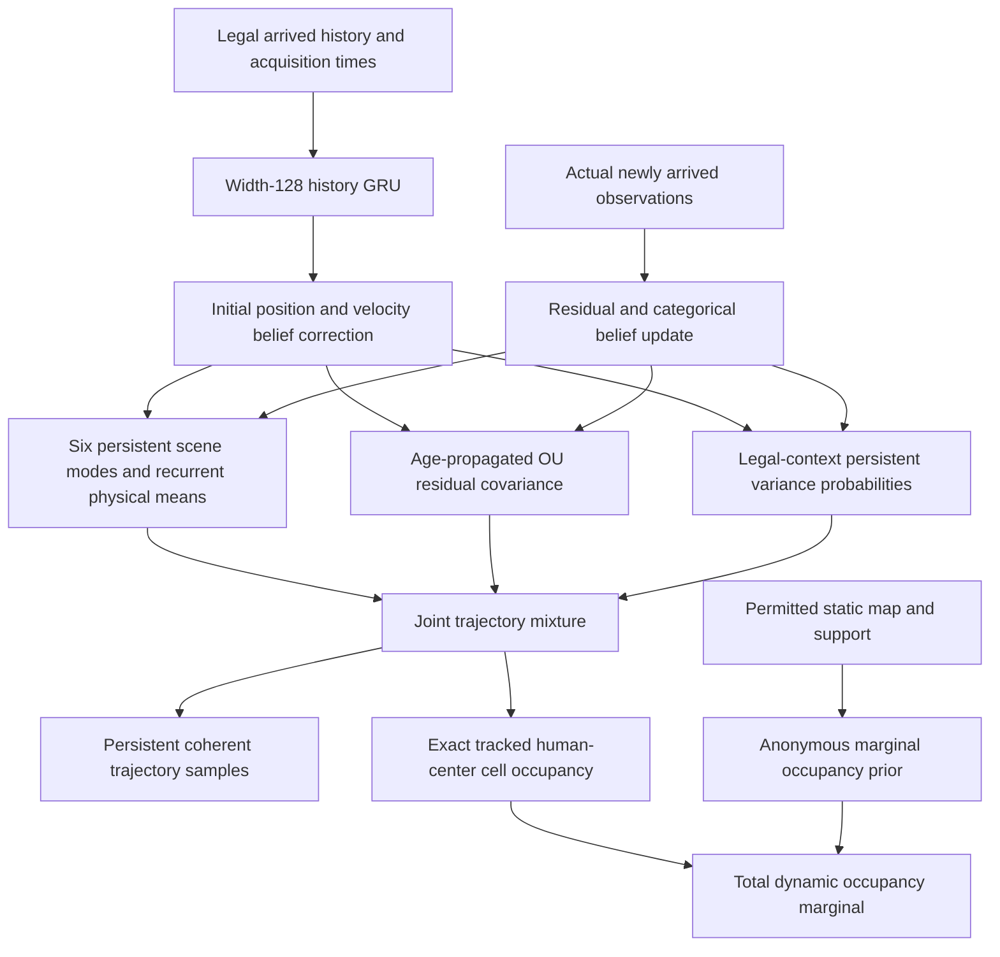

# Performance-v2 architecture and probability contract

The final primary and replicate retain the immutable v1 physical and probability
law. The development-selected age-aware family was rejected for primary promotion
after confirmation and is retained as a named alternative. The diagram and
age/geometry details below describe that implemented alternative; v1 instead
uses age-independent initial covariance, its original variance categories and a
global anonymous occupancy prior. Both share the original recurrent physical
backbone. The optional stopped-motion law is another alternative. Both new
self-only full physical controls completed training but were not selected.

These are forecasting LDMs with recurrent belief interfaces, not the complete
Layer-2 WM. No Query-Conditioned Belief Adapter or joint fine-tuning stage was
implemented. Human dynamics remain independent of candidate robot queries.



## Legal representation

The established adapters provide human histories `[B,N,T,13]`, ego histories
`[B,T,12]`, and explicit float64 frame/acquisition timestamps. Velocity estimates
come from legal observed positions. The candidate robot query does not condition
human dynamics. Future positions, native velocities, simulator identities, goals,
controller states, collision labels and future observations are not encoder inputs.
Target caches are used by training/evaluation, not standalone inference.

The planar frame is fixed to the legal robot pose at encoding. Observation
updates must use that frame and the same relative clock. Tracker IDs identify
slots; their numeric values are not learned features. Padded slots are invalid.
The forecast retains positively observed slots from the supplied history, so
time since last acquisition may exceed the collector's two-second current-table
retention. This is a belief-history distinction, not a tracker repair or ReID.

## Physical transition and controlled alternatives

The incumbent has a width-128 GRU, two interaction layers, six persistent scene
motion modes, legal-history initial-state correction, and 0.25-second recurrent
acceleration residuals. Its deterministic mean speed is bounded at 3 m/s.
Stochastic residual paths are not clipped to that bound. The physical objective
is joint ES plus .05 normalized trajectory NLL, free-running through three seconds.

The matched self-only control preserves parameter count and the learned scene
token, but each agent's component transition attends only to itself and its own
copy of that token. Shared scene-mode probabilities still pool legal histories.
Thus this control removes dynamic cross-agent messages without removing all
scene-level dependence. Intermediate results must justify full-data promotion.

Other bounded controls change distinct-arrival GRU encoding, legal velocity
revision, causal velocity-estimation window, speed/heading dynamics, tracked
occupancy auxiliary weight, or older-window sampling. Their measured outcomes
belong in `ABLATIONS.md`; they are not silently combined into the final model.

Inherited event/legacy occupancy/correction heads remain quarantined: they are
frozen by the physical trainer and unused by the forecasting interface. Stored
parameter count must be distinguished from parameters trained by that objective.

## Structured uncertainty

The residual state contains position and velocity for each coordinate. Its
transition is the exact discretization of integrated OU velocity noise:

```text
dv = -lambda * v * dt + q_c * dW
dp = v * dt
Y[t] = mean[t] + residual_position[t] + readout_noise[t]
```

Age-aware initialization propagates initial covariance through the complete
nonnegative interval since the last actual acquisition, using the same OU
transition and process covariance. This changes state-estimation uncertainty;
future process noise is then accumulated on canonical ticks. It does not claim
that the initial-state mean is an exact posterior or that age alone explains
every calibration error. Small independent readout noise is explicitly part of
the joint law and the reported finite-difference physical-tail diagnostics.

Seven persistent standard-deviation multipliers are `.1, .25, .5, 1, 2, 4, 8`.
Their probabilities depend on eight legal features: age, two age indicators,
velocity validity, estimated speed, mode velocity spread, nearest legal-belief
distance, and legal-track count. All-window calibration averages supported
window likelihood within root and then averages roots; repeated robot queries
are never counted as independent futures. Physical means and OU parameters
remain fixed in these probability controls.

The stopped-motion alternative adds an 18-parameter gate and a persistent
per-agent regime `r` under shared scene mode `z`:

```text
p(Y | history) = sum_z pi_z product_n sum_r p_nr sum_l rho_nrl
                       Normal(Y_n; mean_znr, variance_l * K_zn)
```

The learned branch uses the recurrent physical mean. The stopped branch anchors
at the last legally observed position, plus its propagated OU residual mean.
The gate is fitted only on fitting-root likelihood. The tested half-weight law
halves its fitted stopped probability and gives the remaining mass to the learned
branch; this fixed dilution was declared before its follow-up evaluation.
Full-weight and half-weight results are reported separately. No additional
dilution grid is used.

Every sampled trajectory carries its scene mode, agent regimes, variance
categories, residual state and RNG stream across segments. Sampling does not
redraw unrelated regimes at each tick. Conditional residual innovations remain
independent across agents. Shared scene modes induce dependence, but sampled
residuals do not feed back into the nonlinear social transition. This is not an
exact stochastic interacting-human simulator or an epistemic ensemble.

## Observation correction and recurrence

The belief stores learned physical state, recurrent hidden features, legal slot
support, age, clock, scene weights, unscaled residual covariance, variance
probabilities, and—in the regime model—the legal anchor, stopped residual mean,
and regime probabilities. `encode_history`, `imagine`, and `observe` preserve
the established interface. Direct and composed imagination use the same clock.

Arrived observations update residual state and covariance and apply Bayesian
likelihood updates to variance, regime and scene-mode probabilities. The learned
physical branch retains its original correction rule. Both regimes share the
same unscaled Gaussian covariance update because variance scaling cancels from
the Kalman gain. This remains approximate filtering around nonlinear recurrent
means. Delayed updates allow at most one canonical tick and use the existing
local linear measurement approximation. Repeated/stale acquisitions add no new
evidence. After an observation, draw fresh posterior sample identities.

The public regime forecast's `positions` are means over agent regimes conditional
on scene mode. Exported regime positions/probabilities preserve the full mixture.
`position_variance` includes between-regime spread; belief covariance explicitly
means within-regime residual covariance. Consumers must not substitute one
Gaussian at the mixture mean when computing likelihood or occupancy.

## Occupancy and remaining limits

Tracked occupancy exactly integrates rectangular cell mass under each Gaussian
variance/regime branch, mixes agent branches before the conditional union across
agents, and finally averages scene modes. The grid is human-center occupancy:
32 by 32 cells spanning +/-8 m, rows=y and columns=x. It is not swept-body collision
probability. Unsupported identities do not become negative trajectory labels.

The anonymous component is fitted by rasterizing target humans without an
association to a legal tracked slot, under complete native scene exposure. This
target-only association is applied before rasterization, so an anonymous and a
tracked human may occupy the same cell. It uses only permitted static map/support
at inference: unknown, nonwalkable-navmesh proxy, low clearance, or high clearance.
The geometry-only table uses 128 equivalent roots of shrinkage toward the global
prior. No anonymous identity path is fabricated. Total cell probability is
`1 - (1 - tracked_probability) * (1 - anonymous_probability)`, an explicit
conditional-independence approximation between these two populations.

The anonymous grid and origin clock persist across composition. Its probabilities
cover the first five seconds after encoding; support is false beyond that range.
An observed stable track updates the tracked belief, not the frozen anonymous
prior. A re-encoded history may establish a new frame. The geometry is an eroded
navmesh proxy, not an exact human wall/contact oracle. Supplying the map to an
untrained physical map branch is prevented by the adapter.

Identity existence, new births, changed-ID association, correlated anonymous
trajectories and a complete scene-level posterior are not solved here. Five-second
tracked forecasts extrapolate beyond the three-second physical-training horizon.
No wall-feasibility guarantee is made and no bad samples are removed at evaluation.
These limits remain explicit even if the measured trajectory and occupancy
distribution improves.
